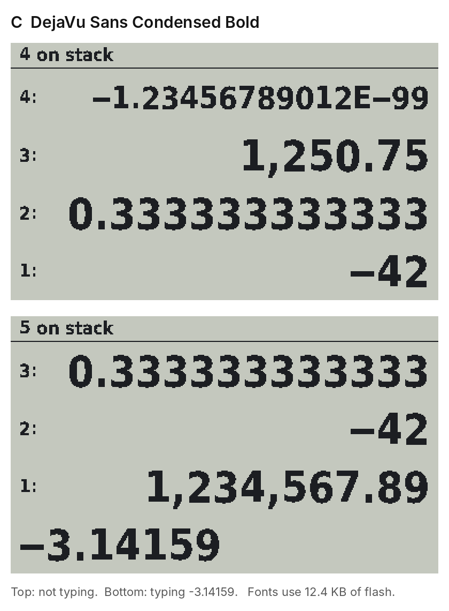
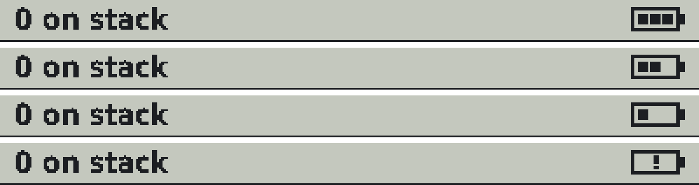

# RPN Calculator — Design

A simple hardware RPN calculator, with a matching phone web app. Both must behave identically.

## Scope
- Operations: + − × ÷ and square root only (no trig)
- RPN behaviour modelled on HP; entry style follows the HP 48
- 12-digit resolution, BCD (decimal) arithmetic
- Kept deliberately simple

## Entry and stack behaviour (HP 48 style)
- Typing goes onto a left-justified command line
- ENTER pushes the command line once; it duplicates only when nothing is typed
- 4 equal stack lines on screen, with no separate X line; the stack itself is unlimited
- Separate Backspace and Drop keys
- No EEX key

## Screen
- 400 × 240 Sharp Memory LCD: a status line (stack depth or error message on the left, battery icon on the right), then 4 equal lines
- Not typing: levels 4–1, numbers right-justified. Typing: levels 3–1, with the command line left-justified at the bottom
- Numbers: 12 significant digits, thousands grouped with commas, scientific notation when they don't fit, true minus sign
- Battery icon: 3, 2, 1 bars, then an empty outline with "!" when low; the supply is measured against VREFINT, with no extra parts

## Power and sleep
- CR2032 coin cell
- No On/Off key: auto-off after 5 minutes, with the stack kept in RAM
- Holding Clear for 3 s switches off; Clear acts on release
- The stack is not saved to flash on battery swap
- Battery voltage monitoring

## Firmware updates
- USB-C is used for firmware updates and powers the device while updating; it is not a normal power source
- Hold SWAP while plugging in USB-C to enter update mode
- A recovery button for corrupt firmware, reachable through a 1 mm hole in the case
- SWD header on the PCB (pads with a soldered header)

## Hardware
- MCU: STM32L476 (prototyped on a Nucleo L476RG)
- Display: Sharp Memory LCD 2.7" (Adafruit board for the prototype)
- Font: DejaVu Sans Condensed Bold, status line included
- Keys: Kailh Choc V1 for the final build; cheaper buttons for the prototype
- 3-wide Enter key with a stabiliser and one centre switch
- Key layout matches the phone app
- PCB: bare board from the fab, all parts hand-soldered by Alex
- Enclosure: 3D-designed, printed case

## Status (Nov 2026)
- Working on the Nucleo: display, keypad, BCD maths, real sleep and auto-off
- Next: a full-circuit prototype using a 64-pin LQFP breakout for the STM32, SOT-23 adapter boards, and the existing perfboard keypad on a header, before committing to the keypad PCB

## Open items
- Pin map
- Power budget and CR2032 peak-current check
- USB-C / battery power path
- Key matrix layout
- BOM
